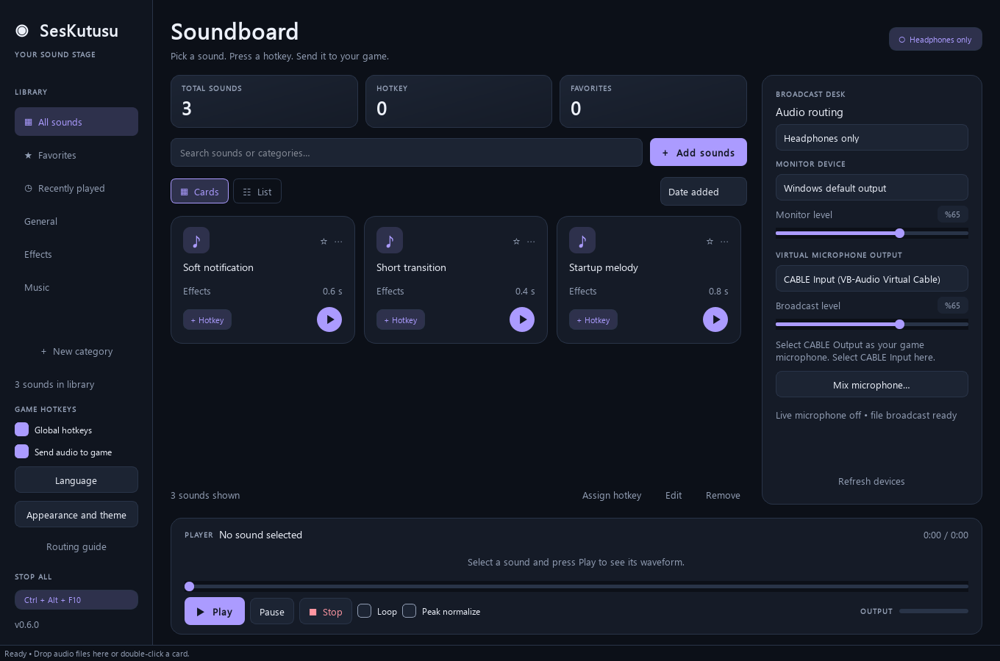

# SesKutusu

A Windows desktop soundboard for playing local audio files through headphones and a virtual microphone. Built with Python and PySide6.



## Features

- Local audio library with search, categories, favorites and recent sounds.
- Global Windows hotkeys, including distinct number-row and numpad bindings.
- Headphone monitoring and virtual microphone output, with optional live microphone mixing.
- Playback, pause, seek, loop, waveform preview and WAV trimming.
- Four themes, four accent colors, compact mode and a theme-matched native Windows title bar.
- Turkish, English, German, Spanish, French, Portuguese, Russian and Arabic; Arabic uses a right-to-left layout.

This public source edition is **0.6.0**. It imports files already on your computer. It does not include website downloaders, third-party sound collections, virtual audio drivers or prebuilt application binaries. Its demonstration tones are synthesized locally by the application. English is the default interface language; other languages remain available through the language menu.

## Run from source

Use 64-bit Python 3.12 from [python.org](https://www.python.org/downloads/windows/) on Windows 10/11.

```powershell
py -3.12 -m venv .venv
.\.venv\Scripts\python.exe -m pip install -r requirements.txt
.\.venv\Scripts\python.exe app.py
```

Your library and preferences are created in the local `data/` directory. Keep that directory private; it is excluded from Git. An alternate location can be set with `--data-dir PATH`.

## Send audio to Discord or a game

1. Obtain a compatible virtual audio driver separately. [VB-CABLE](https://vb-audio.com/Cable/) is one option; follow its own licensing and installation terms.
2. In SesKutusu, choose **Headphones + microphone** and select **CABLE Input** as the virtual microphone output. Select your physical headphones or speakers for monitoring.
3. In Discord or your game, select **CABLE Output** as the microphone input. Select your physical headphones/speakers as its output device.
4. Assign a sound a hotkey or press Play. SesKutusu must remain running for global hotkeys to work.
5. To include your voice, open **Mix microphone**, choose your physical microphone and start the broadcast.

Voice isolation or noise suppression in the receiving application may suppress sound effects. Test its unprocessed/studio input mode where available. **Ctrl+Alt+F10 stops file playback; Stop broadcast also stops the live microphone.**

SesKutusu does not change the Windows default microphone automatically. Use only audio you are entitled to use, and follow the receiving service's rules.

## Development and tests

```powershell
.\.venv\Scripts\python.exe -m unittest discover -s tests -v
```

Tests synthesize their audio or use temporary files; no copyrighted music samples are included. GitHub Actions is configured to run the tests on Windows with Python 3.12. The workflow does not publish releases.

The Windows integration is in `hotkeys.py` and `window_chrome.py`; playback and microphone mixing are in `audio_engine.py` and `broadcast.py`. This edition supports one file at a time and files up to ten minutes. It does not guarantee compatibility with every game's input handling or anti-cheat software.

## License and distribution

The original SesKutusu code and artwork in this repository are available under the [MIT License](LICENSE). Dependencies retain their own licenses; see [third-party notices](THIRD_PARTY_NOTICES.md).

This is an independent project and is not affiliated with Soundpad, Discord, VB-Audio or the Qt Company. Product names identify compatibility only. No affiliation or third-party endorsement is claimed.

Before distributing an EXE or bundling dependencies, complete the [binary distribution checklist](docs/DISTRIBUTION.md). Publishing this source repository does not establish compliance for a separate binary bundle.
